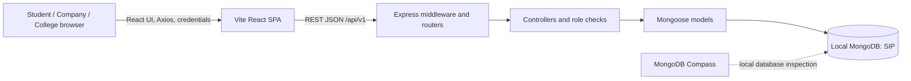
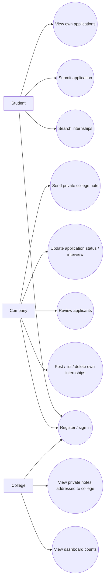
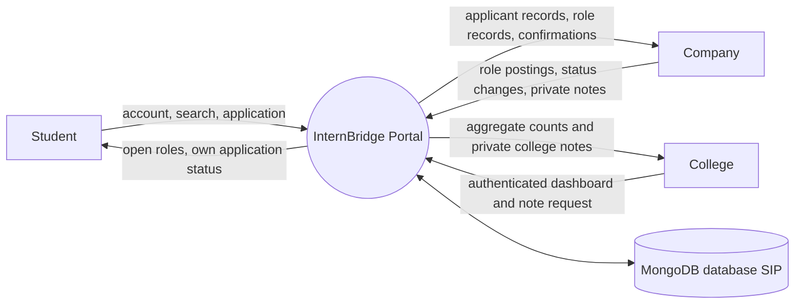
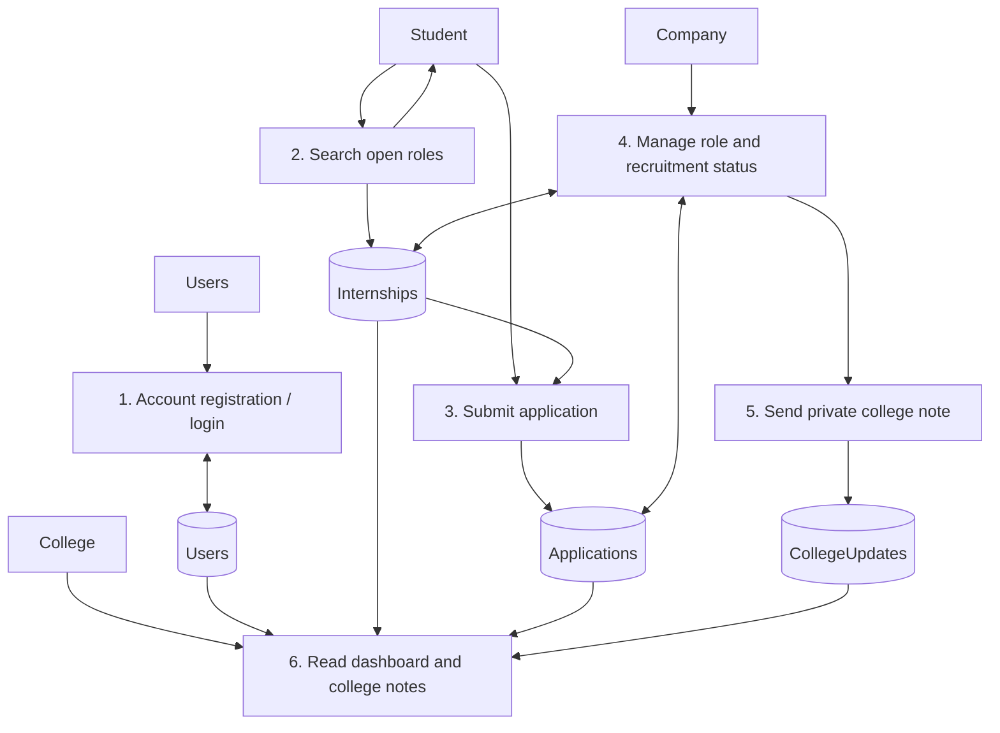
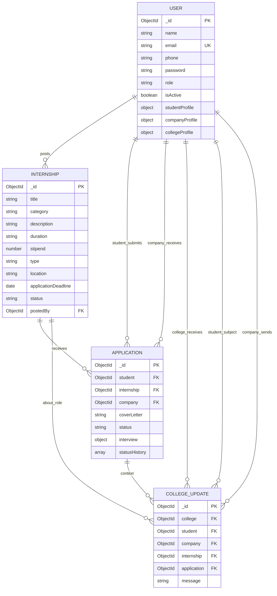
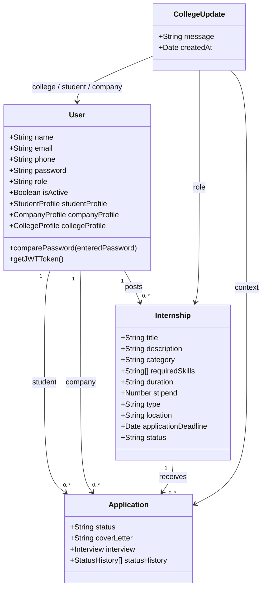
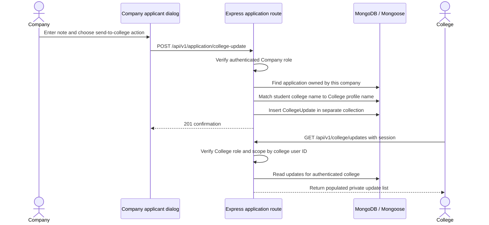
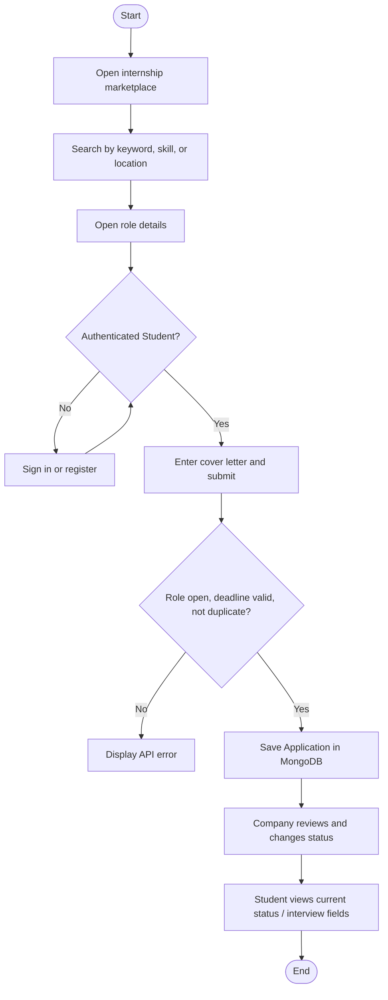

# InternBridge: Centralized Internship Portal

## 1. Cover Page

**Project title:** InternBridge – Centralized Internship Portal  
**Project domain:** Web application / internship recruitment management  
**Submitted in partial fulfilment of:** [Degree / Course / Semester]  
**Submitted by:** [Student name]  
**Roll / Registration number:** [Number]  
**Department:** [Department]  
**Institution:** [College / University]  
**Project guide:** [Guide name and designation]  
**Academic year:** [Academic year]  
**Submission date:** [Date]

> Replace every bracketed field with institution-approved details before submission.

## 2. Certificate

This is to certify that **[Student name]**, bearing **[Roll / Registration number]**, of **[Department, Institution]**, has completed the project entitled **“InternBridge: Centralized Internship Portal”** during **[Academic year]** under the guidance of **[Guide name]**. The project report is submitted in partial fulfilment of the requirements for **[Degree / Course]**.

| Project guide | Head of department | External examiner |
|---|---|---|
| Signature: __________ | Signature: __________ | Signature: __________ |
| Name: __________ | Name: __________ | Name: __________ |
| Date: __________ | Date: __________ | Date: __________ |

*This certificate is a template and must be reviewed and signed by the institution.*

## 3. Declaration

I, **[Student name]**, declare that this report entitled **“InternBridge: Centralized Internship Portal”** describes the project implementation reviewed in the accompanying repository. I have identified incomplete functionality and have not represented unexecuted tests as passed. Sources, institutional material, and any externally prepared content used in the final submission will be acknowledged according to the institution’s rules.

**Place:** [Place]  
**Date:** [Date]  
**Student signature:** ____________________

## 4. Acknowledgement

I express my gratitude to **[Project guide]**, **[Department / Institution]**, and the faculty members who provided guidance and feedback during this project. I also thank the project reviewers and peers who contributed suggestions. Any additional assistance or external material should be added here before submission.

## 5. Abstract

InternBridge is a locally runnable web application intended to coordinate internship discovery and recruitment among students, companies, and colleges. Its React interface communicates with an Express REST API, which stores user profiles, internship postings, applications, status history, and college progress notes in MongoDB through Mongoose. A student can browse open internships, search by text, required skill, and location, submit a cover letter, and review the current application status. A company can create and delete its own postings, review applications for its account, change application status, and schedule interview details. A college account can view dashboard counts and receive separate company progress notes associated with students whose profile college name matches that college account.

The repository includes a repeatable demo-data seed script for one college, three company accounts, three student accounts, internships, applications, and sample college notes. The project is configured for a local MongoDB server; MongoDB Compass can be used as a database client. The application does not implement email/push notifications, resume upload, a student profile editor, verified college membership, or a production deployment workflow. College metrics are platform-wide, and the college student/company/analytics API routes do not all have corresponding screens in the routed frontend. At the time of report preparation, the demo seed script had completed successfully against the local `SIP` database. Frontend build and lint checks did not pass in the recorded verification: the build process encountered an environment access error, and ESLint reported existing errors. No automated application test suite is defined.

## 6. Table of Contents

1. Cover Page  
2. Certificate  
3. Declaration  
4. Acknowledgement  
5. Abstract  
6. Table of Contents  
7. List of Figures and Tables  
8. Chapter 1 – Introduction  
9. Chapter 2 – Literature Survey / Existing Systems  
10. Chapter 3 – Requirement Analysis  
11. Chapter 4 – System Design  
12. Chapter 5 – Technology Stack  
13. Chapter 6 – Implementation  
14. Chapter 7 – Testing  
15. Chapter 8 – Results and Screenshots  
16. Chapter 9 – Conclusion  
17. Chapter 10 – Future Scope  
18. References  
19. Appendix

## 7. List of Figures and Tables

### Figures

| Figure | Title | Status |
|---|---|---|
| 4.1 | Application architecture | Diagram specified below |
| 4.2 | Use-case diagram | Diagram specified below |
| 4.3 | Context-level data-flow diagram | Diagram specified below |
| 4.4 | Level-1 data-flow diagram | Diagram specified below |
| 4.5 | MongoDB entity-relationship diagram | Diagram specified below |
| 4.6 | Domain class diagram | Diagram specified below |
| 4.7 | Application submission sequence | Diagram specified below |
| 4.8 | Private college update sequence | Diagram specified below |
| 4.9 | Student application activity flow | Diagram specified below |
| 8.1 | Landing page | Capture from running project required |
| 8.2 | Registration and sign-in | Capture from running project required |
| 8.3 | Internship search/list | Capture from running project required |
| 8.4 | Student application tracker | Capture from running project required |
| 8.5 | Company applicant management | Capture from running project required |
| 8.6 | College dashboard and private notes | Capture from running project required |

### Tables

| Table | Title |
|---|---|
| 3.1 | Functional requirements |
| 3.2 | Non-functional requirements and limitations |
| 3.3 | User requirements by role |
| 3.4 | Hardware and software requirements |
| 4.1 | Main data entities and relationships |
| 5.1 | Implemented technology stack |
| 6.1 | API route reference |
| 7.1 | Verification performed during report preparation |
| 7.2 | Functional test cases (execution status) |
| A.1 | Important API endpoints |
| A.2 | MongoDB model field summary |

## 8. Chapter 1 – Introduction

### 1.1 Background

Internship recruitment involves opportunity publication, candidate discovery, application review, status communication, and institutional oversight. The repository implements a web-based workflow that places these operations behind role-based accounts. Its primary roles are `Student`, `Company`, and `College`. The server also permits an `Admin` value in the user model and in certain posting-management branches, but there is no admin registration option or admin interface in the frontend.

### 1.2 Problem Statement

The project addresses the organizational problem of tracking internships and applications across separate user groups. Its implemented workflow centralizes open postings, student applications, company-side review, and college-only progress notes in one local web application. The repository does not provide evidence of a field study or quantified baseline; therefore, the problem is presented as the project’s intended use case rather than a measured institutional finding.

### 1.3 Motivation

The project’s stated motivation is to provide a single portal for internship discovery, recruitment, and progress tracking. Its implementation provides separate views for student, company, and college accounts and uses MongoDB to persist the core records.

### 1.4 Objectives

The objectives reflected in the implemented code are:

1. Provide account registration, sign-in, sign-out, and current-user retrieval for the three UI roles.
2. Store company-created internship postings in MongoDB.
3. Let students browse open roles and filter them by free-text terms, required skill, and location.
4. Store student applications and prevent duplicate applications to the same internship.
5. Let the owning company change application statuses and enter interview details.
6. Let companies send separate progress notes to the college account matched to a student’s college name.
7. Provide role-specific dashboard views and a repeatable demo-data seed command.

### 1.5 Scope

The scope is the local MERN-style application in this repository. The frontend is a Vite-built React single-page application; the backend is an Express API; MongoDB is accessed using Mongoose. The system supports local development using a MongoDB connection string such as `mongodb://127.0.0.1:27017/SIP`. Compass is an optional client for viewing this database; it is not the database server.

### 1.6 Existing System

No existing institutional process, dataset, or competitor analysis is documented in the repository. As a general problem framing, internship workflows may be maintained through separate postings, forms, and communication channels. This report does not claim that a particular college currently uses such a process.

### 1.7 Proposed System

The proposed system is the implemented portal: companies post roles, students search and apply, companies update application progress, and colleges view aggregate dashboard information and separately stored private notes. The API persists the records in MongoDB. The UI sends REST requests using Axios and an API base URL configured by `VITE_API_URL`, with a local development fallback in frontend source.

### 1.8 Advantages

- Centralized internship and application records.
- Role-specific user experiences for students, companies, and colleges.
- Duplicate application prevention through controller validation and a unique compound database index.
- Search by title/keyword, skill, and location for open, not-yet-expired postings.
- Application status history and interview fields stored with each application.
- College progress notes stored separately from the student application response and retrieved through a College-role-checked endpoint.
- Demo records can be inserted or updated using `npm run seed:demo`.

These are code-supported properties; they do not establish production readiness or institutional adoption.

## 9. Chapter 2 – Literature Survey / Existing Systems

The repository contains no literature-review section, academic citations, external benchmark, or formal comparison dataset. A verified scholarly literature survey therefore cannot be reconstructed from the source code alone. For this report, the comparison below describes the system’s functional boundary, not an empirical ranking of other products.

| Workflow area | Separate/manual workflow (general framing) | Implemented portal behavior |
|---|---|---|
| Opportunity visibility | Roles can be distributed across multiple channels | Public internship listing endpoint and marketplace screen |
| Application records | Candidate submissions may be held separately from role data | `Application` documents reference student, company, and internship |
| Recruitment progress | Updates can be communicated outside a common record | Company can change an application’s status and interview details |
| College oversight | Institutional information can require separate reporting | College dashboard counts and a private college-update feed exist |
| Data persistence | Depends on the chosen tools | MongoDB persistence is implemented through Mongoose |

The portal only partially closes these workflow gaps. It has no outbound notification service, institution verification process, college-to-student enrollment mapping, audit export, or complete college administration UI. The college dashboard counters are platform-wide rather than scoped to the account’s institution.

## 10. Chapter 3 – Requirement Analysis

### 3.1 Functional Requirements

**Table 3.1 – Functional requirements**

| ID | Requirement | Implemented behavior |
|---|---|---|
| FR-01 | Register an account | `POST /user/register`; accepts name, email, phone, password, role (Student, Company, College) |
| FR-02 | Sign in and sign out | `POST /user/login`; `GET /user/logout`; login requires selected role to match account role |
| FR-03 | Retrieve current account | `GET /user/me`; authenticated through cookie or Bearer token |
| FR-04 | Update user profile | `PUT /user/update-profile`; backend merges role-specific profile data; no profile-edit screen is routed in the UI |
| FR-05 | Browse/search internships | `GET /internship/getall`; filters include `search`, `role`, `skill`, `location`, `type` |
| FR-06 | View an internship | `GET /internship/:id` |
| FR-07 | Create/manage company postings | Create/update/delete handlers exist and UI includes create/list/delete, but current GET route order shadows `/my-internships`; the company listing workflow is partially implemented and currently broken until route order is corrected |
| FR-08 | Apply for an internship | Student submits an internship ID and cover letter; duplicate and deadline checks are present |
| FR-09 | Track applications | Student can list own applications and view current status/interview details |
| FR-10 | Review applicants | Company can list only its own applications and applications for its posted role |
| FR-11 | Update recruitment status | Company can set one of six statuses; interview details are stored for the interview-scheduled state |
| FR-12 | Send a college-only note | Company submits a note for an application; server resolves student college name to a College user and stores a `CollegeUpdate` |
| FR-13 | College oversight | College dashboard displays aggregate counts and a note feed; other student/company/analytics endpoints exist in API but lack routed screens |
| FR-14 | Seed example records | `backend/scripts/seedDemo.js` creates/updates demo accounts, internships, applications, and sample college updates |

### 3.2 Non-Functional Requirements and Limitations

**Table 3.2 – Non-functional requirements**

| Area | Implemented or documented property | Limitation / status |
|---|---|---|
| Usability | Responsive React interface and role-specific navigation | Actual usability evaluation is not present |
| Persistence | MongoDB through Mongoose models | Requires MongoDB Community Server running locally or a compatible MongoDB URI |
| Authentication | JWT in an HTTP-only cookie; Bearer token is also accepted | Local fallback signing secret is defined in source; production must set a private `JWT_SECRET_KEY` |
| Password handling | Passwords are hashed using bcrypt with cost 10 before save | No password reset or multi-factor flow |
| Authorization | Many controller handlers enforce role and ownership checks | `GET /application/:id` does not reject College/Admin roles after authentication; see security limitation in Chapter 6 |
| Error reporting | Central Express middleware maps validation, duplicate-key, cast, and JWT errors to JSON | No structured logging or monitoring service |
| Performance | MongoDB indexes include unique user email and unique student/internship application pair | No load/performance results or pagination for the major listing endpoints |
| Availability | Local API and database setup documented | No deployment, backup, recovery, or uptime configuration is included |
| Accessibility | Semantic labels are present on many forms | No formal accessibility audit is included |

### 3.3 User Requirements

**Table 3.3 – User requirements by role**

| User | Code-supported tasks | Not implemented / partial |
|---|---|---|
| Student | Register/sign in; search/browse roles; submit cover letter; view applications and current status/interview | Student profile editor, resume upload, profile project editor, status-history timeline, and college-private notes are not exposed in student UI |
| Company | Register/sign in; post and delete own roles; view own applicants; update status/interview; send private note to matched college | The GET route collision prevents the own-posting list from reaching its controller, affecting dashboard/role-list behavior. Company profile editor, posting edit form, and actual email/push notifications are not implemented |
| College | Register/sign in; view global counts; view notes addressed to own college account | Student/company/analytics screens are not implemented in the routed UI; counts and existing admin data APIs are global rather than institution-scoped |
| Admin | No UI registration or dashboard | Admin use is only partially admitted by some backend posting-management branches; there is no defined admin workflow |

### 3.4 Hardware and Software Requirements

**Table 3.4 – Requirements**

| Category | Requirement |
|---|---|
| Hardware | A development computer capable of running Node.js, a modern browser, and MongoDB Community Server. No minimum CPU, RAM, or disk requirement is specified by the project. |
| Operating system | README includes Windows-compatible temp-file handling; Node.js and MongoDB are expected to be installed locally. Other operating systems are not explicitly tested in this report. |
| Runtime | Node.js 18 or later, per README. The previously observed local environment used a newer Node 24 runtime; compatibility matrix is not documented. |
| Frontend | React 18, Vite 5, React Router 6, Axios; dependencies are recorded in `frontend/package.json` and lockfile. |
| Backend | Express 4, Mongoose 8, dotenv, bcrypt, jsonwebtoken, cors, cookie-parser, express-fileupload. |
| Database | MongoDB Community Server with database name `SIP` in the local example configuration. |
| Optional database client | MongoDB Compass; connects to the local MongoDB server but does not start it. |
| Browser | A current browser with JavaScript enabled; no specific browser certification or matrix exists. |
| Development tools | npm, Vite, ESLint, Git; Visual Studio Code settings may exist in the local workspace. |

### 3.5 Constraints

1. The backend starts with a local MongoDB URI fallback; it does not install or start MongoDB.
2. Student-college linkage is a string (`studentProfile.college`) matched against `collegeProfile.collegeName`; there is no formal student enrollment relation.
3. College metrics and several college APIs query data platform-wide.
4. The UI does not expose every backend API or every schema field.
5. Resume fields exist in the user/application models, but file upload/storage flow is not implemented. Cloudinary is configured in `server.js`, but no controller uses it.
6. Application status notes and college progress notes have different visibility paths. The separate `CollegeUpdate` API is College-role restricted; the application status history is returned by application endpoints.
7. Demo credentials are fixed in the seed script and intended only for local demonstration.
8. Build/lint verification is currently not clean; see Chapter 7.
9. In `backend/routes/InternshipRoutes.js`, `GET /:id` is registered before `GET /my-internships`. Express matches `/my-internships` as `:id`, causing an invalid ObjectId error before the intended handler is reached. The company dashboard also waits for this endpoint, so it can fail to load its summary. Place the specific `/my-internships` route before `/:id` to correct this.

## 11. Chapter 4 – System Design

### 4.1 Architecture

The application uses a browser-to-API-to-database architecture. The Vite/React single-page application issues HTTP requests to Express. Express middleware parses JSON, cookies, URL-encoded requests, and file-upload multipart data; route handlers invoke controllers and Mongoose models. The models persist to MongoDB. MongoDB Compass is an optional administrative client outside the request path.

**Figure 4.1 – Application architecture**



### 4.2 Use-Case Diagram

**Figure 4.2 – Implemented user use cases**



Profile editing and the college student/company/analytics screens are omitted from the diagram because they are not exposed as complete frontend use cases.

### 4.3 Data-Flow Diagrams

**Figure 4.3 – Context-level DFD**



**Figure 4.4 – Level-1 DFD**



### 4.4 Database / Data Model

Mongoose models map to MongoDB collections named by Mongoose from the model names (`users`, `internships`, `applications`, and `collegeupdates`, subject to Mongoose collection naming). Timestamps are enabled on all four schemas. ObjectId references are used for company/student/internship/application relationships, while student-to-college association remains a text value.

**Table 4.1 – Main data entities and relationships**

| Entity | Important attributes | Relationships / behavior |
|---|---|---|
| User | name, email (unique, validated), phone, password (select false, bcrypt pre-save), role, isActive, timestamps; nested student/company/college profiles | A company posts many internships; students submit applications; colleges are matched by profile name for private notes |
| Internship | title, description, category, requiredSkills, duration, stipend, type, location, openings, applicationDeadline, certificateProvided, ppoOpportunity, status, postedBy, timestamps | `postedBy` references User; application references Internship |
| Application | student, internship, company, resume reference, coverLetter, status, interview object, statusHistory, timestamps | References User and Internship; unique compound index on student + internship |
| CollegeUpdate | college, student, company, internship, application, message, timestamps | Separate collection; company note recipient is the matched College user |

`Application.status` is restricted to `Applied`, `Under Review`, `Shortlisted`, `Interview Scheduled`, `Selected`, or `Rejected`. Internship type is `Remote`, `Hybrid`, or `On-site`; internship status is `Open` or `Closed`.

**Figure 4.5 – MongoDB ER diagram**



### 4.5 Class Diagram

The diagram represents implemented persistent domain models and principal references; it is not a claim that Mongoose models are conventional in-memory object-oriented service classes.

**Figure 4.6 – Domain class diagram**



### 4.6 Sequence Diagrams

**Figure 4.7 – Student application submission**

```mermaid
sequenceDiagram
  actor Student
  participant UI as React application form
  participant API as Express application route
  participant DB as MongoDB / Mongoose
  Student->>UI: Submit internship ID and cover letter
  UI->>API: POST /api/v1/application/apply + session cookie
  API->>API: Verify JWT and Student role
  API->>DB: Find internship; check status and deadline
  API->>DB: Check existing student/internship application
  alt Valid and not already applied
    API->>DB: Insert Application and initial status history
    API-->>UI: 201 success with application
    UI-->>Student: Show confirmation and open application tracker
  else Invalid, expired, or duplicate
    API-->>UI: JSON error and HTTP error status
    UI-->>Student: Show error toast
  end
```

**Figure 4.8 – Company private note to college**



### 4.7 Activity Diagram

**Figure 4.9 – Student application activity**



### 4.8 System Workflow

1. The browser loads the React app and calls `/user/me` to restore session state.
2. Registration or login sends the selected role and credentials to the user API. The server validates the role, hashes a new password or compares an existing hash, and returns a JWT in an HTTP-only cookie (and response JSON).
3. The user browses appropriate screens. Backend middleware verifies the token for protected endpoints; controllers enforce role and ownership checks for the main workflows.
4. The student searches internships, opens a role, and submits a cover letter. The API validates the target internship, deadline, and duplicate condition before inserting an application.
5. The owning company retrieves applicants and updates the application status. Interview date, mode, and meeting link can be saved with an interview-scheduled status.
6. A company can separately send a private note. The backend matches the student's college string to a College profile and stores a `CollegeUpdate`. A College-role endpoint returns notes addressed to that college.

## 12. Chapter 5 – Technology Stack

**Table 5.1 – Implemented technology stack**

| Layer | Technology | Evidence / use |
|---|---|---|
| Frontend | React 18, JavaScript, Vite 5, React SWC plugin | `frontend/package.json`, Vite config, `src` |
| Routing | React Router DOM 6 | `BrowserRouter`, `Routes`, `Route`, `Navigate`, `Link` |
| HTTP | Axios | Frontend calls Express endpoints; credentialed requests use `withCredentials` |
| Interface feedback | react-hot-toast | Success and error notifications |
| Icons | react-icons / Heroicons package | Dashboard, homepage, and navigation icons |
| Backend runtime | Node.js ES modules | `backend/package.json` uses `type: module` |
| Web API | Express 4 | Routers, middleware, JSON response handlers |
| ODM / data | Mongoose 8 | Schema validation, model references, queries, populate, aggregation |
| Database | MongoDB Community Server | Local `DB_URL` example targets `SIP` database |
| Password hashing | bcrypt | User pre-save hook hashes password with cost 10 |
| Authentication | jsonwebtoken | JWT issue and verification; cookie or Bearer header accepted |
| Configuration | dotenv | Backend `.env` is resolved relative to `backend/app.js`; frontend uses Vite env plus a localhost fallback |
| Cross-origin/session support | cors, cookie-parser | CORS allows configured frontend origin with credentials; cookies parsed by Express |
| File-related middleware | express-fileupload | Temporary-file support configured in `app.js`; no end-user upload feature is implemented |
| Cloud file service | Cloudinary package | Credentials are configured by `server.js`; no upload controller currently calls Cloudinary |
| Development checks | ESLint, npm scripts | Frontend has `build` and `lint`; backend has `start`, `dev`, `seed:demo`; no test script |

### 5.1 APIs

The API is a JSON REST-style interface mounted below `/api/v1`. It is implemented in Express routers/controllers. No OpenAPI/Swagger schema, generated SDK, GraphQL endpoint, or version negotiation is included.

### 5.2 Authentication and Security

- Passwords are not selected by default in user queries and are hashed by a Mongoose pre-save hook.
- JWT payload contains user ID and role; token expiry defaults to seven days unless environment variables override it.
- The token is set as an HTTP-only cookie, and authentication middleware also permits an Authorization Bearer token.
- Cookie `sameSite` is `lax` in development; production configuration uses `sameSite: none` and `secure: true`.
- CORS uses one configured frontend origin and allows credentials.
- Several controllers verify both role and ownership, particularly company internship/application actions.
- Security limitations: source includes a fixed local-development JWT fallback; production must use a strong private key. The login token is also included in JSON response. There is no rate limiting, email verification, CSRF-specific mechanism, password reset, or centralized audit logging. The general single-application endpoint lacks an explicit rejection for College/Admin roles, so role access there requires correction before production use.

## 13. Chapter 6 – Implementation

### 6.1 Project Structure

```text
Internship-portal/
├── README.md
├── backend/
│   ├── app.js, server.js
│   ├── controllers/       # account, internship, application, dashboard, college
│   ├── database/          # MongoDB connection
│   ├── middlewares/       # authentication, async wrapper, error handling
│   ├── models/            # User, Internship, Application, CollegeUpdate
│   ├── routes/            # Express route declarations
│   ├── scripts/seedDemo.js
│   ├── utils/jwtToken.js
│   ├── .env.example
│   └── package.json
└── frontend/
    ├── index.html, vite.config.js, tsconfig.json
    ├── public/            # login/register/not-found art, logos, sample CV images
    ├── src/App.jsx, main.jsx, App.css
    └── src/components/    # Auth, Home, Internship, Application,
                            # Dashboard, Layout, College, Company, NotFound
```

Some legacy dashboard component files under `components/College` and `components/Company` are not imported by the routes in `App.jsx`; the active dashboard routes use `components/Dashboard`. `ResumeModal.jsx` is present but not imported by an active route. Several logo/CV assets are stored in `public`; not all are referenced in the active UI. The declared GET route order means `/internship/my-internships` currently reaches `/:id` and fails ID casting, affecting the company dashboard and role-list screen until corrected.

### 6.2 Frontend

`main.jsx` creates a React context containing current user, authorization state, and loading state. `App.jsx` checks `/user/me` on mount and declares routes for the homepage, authentication, internship marketplace/details/apply flow, student dashboard/application tracker, company dashboard/post/list/applicant pipeline, and college dashboard. Screens perform their own authorization and role redirects; the `ProtectedRoute` helper in `App.jsx` is declared but is not used, and it contains a reference to `isAuthorized` that is not destructured in that helper. This is one cause of the reported lint failure.

The marketplace calls `GET /internship/getall` when its search inputs change. It offers title/keyword, required skill, and location text inputs. `type` is supported by the API query but is not provided as a marketplace input. Category links pass a query parameter named `category`, which the UI forwards to the API as `role` and the API treats as a text-search term.

The home page contains marketing copy, example-company cards, category cards, and illustrative numeric metrics. These values are static frontend content; they are not live counts and should not be presented as measured project results.

### 6.3 Backend and APIs

`app.js` configures dotenv, CORS, cookie parsing, JSON and URL-encoded parsing, temporary-file upload middleware, routes, database connection, and error middleware. `server.js` starts the HTTP listener and configures Cloudinary credentials. Controllers implement database access and role checks. Async controller errors are passed to the central error middleware.

### 6.4 Database

Mongoose models persist account profiles, postings, applications, and separate college notes. The application schema includes a unique compound index on `(student, internship)`. MongoDB creates the `SIP` database when data is first written; Compass can connect using the configured URI. Student-college linkage is string-based, not an ObjectId reference.

### 6.5 Authentication

Registration accepts only `Student`, `Company`, or `College`, requires name/email/phone/password/role, and creates a User record. The login handler requires email/password/role, compares the bcrypt hash, checks that the selected role matches, and checks `isActive`. There is no verification email or role-specific profile data collected on the registration screen. Profile model subdocuments and a backend update endpoint exist, but no active profile-edit page is present.

### 6.6 Important Logic

- Internship list search: open postings whose deadline is current/future are queried; optional text terms are matched against title, category, description, or required skills; skill and location filters are additionally applied.
- Application creation: verifies Student role, internship existence/open status/deadline, then checks duplicates before insertion. A database unique index is an additional duplicate guard.
- Company ownership: company posting updates/deletes and applicant views check that the posting/application belongs to the logged-in company.
- College note routing: a note is accepted only from a Company account with an application owned by that company. Student profile college text is matched case-insensitively to `collegeProfile.collegeName`. A `CollegeUpdate` is stored separately and read through a College-only route scoped to the logged-in college ID.
- Seed behavior: `seedDemo.js` loads backend `.env`, connects using `DB_URL` or the local SIP fallback, and upserts known demo users, roles, applications, and sample college notes. It resets demo account passwords to the documented shared demo password when rerun. It does not clear the entire database.

### 6.7 Error Handling

`catchAsyncErrors` forwards rejected async handlers to Express `next`. `errorMiddleware` returns `{ success: false, message }` JSON and handles duplicate key, Mongoose validation, cast, and JWT errors. Frontend API forms display returned `message` values through toast notifications when available. The backend does not define a general health endpoint or structured request logger.

### 6.8 Implemented vs. Incomplete Functionality

| Feature | Status | Evidence-based note |
|---|---|---|
| Student/company/college register and sign-in | Implemented | Common form and role-aware backend logic |
| Student internship search | Implemented, partial | Free text, skill, location; no advanced ranking or recommendation model |
| Internship post/list/delete | Partially implemented | Posting/deleting handlers and UI exist; own-list endpoint is shadowed by `GET /:id`; update API exists but no edit UI; requiredSkills entry absent from posting form |
| Apply and view current status | Implemented | Application and student screens; status timeline is not rendered |
| Interviews | Partially implemented | Fields can be saved and displayed; no calendar integration or notification |
| Company-to-college private note | Implemented | Separate collection and College-only read endpoint; only matched college account receives it |
| College oversight | Partially implemented | Global counts and note screen; no institution scoping or routed student/company/analytics screens |
| Student project tracking | Partially implemented | Projects schema exists and seed includes a sample project; no student project CRUD UI or milestone tracking |
| Resume upload | Not implemented | Resume fields and upload middleware exist; no upload controller/Cloudinary call/UI flow |
| Email/SMS/push notifications | Not implemented | No notification provider/service appears in source |
| Admin portal | Not implemented | Role enum and some controller branches only |
| Automated test suite | Not implemented | No backend/frontend test script or test files are present in the tracked source inventory |

## 14. Chapter 7 – Testing

### 7.1 Testing Strategy

Appropriate next-stage testing includes controller/unit tests for validation and role gates, API integration tests against a disposable MongoDB database, UI tests for each role workflow, and database checks for references/indexes. These are recommended test activities, not evidence that those suites exist. No automated test framework or test script is defined in either package manifest.

### 7.2 Verification Performed for This Report

**Table 7.1 – Recorded verification**

| Check | Result | Evidence / interpretation |
|---|---|---|
| Demo seed command (`npm run seed:demo`) | **Completed successfully** | Command output reported demo data ready in database `SIP`; this verifies the seed command connected and completed, not every UI/API workflow |
| Frontend production build (`npm run build`) | **Failed / environment-limited** | Vite/esbuild reported `Cannot read directory "../../../..": Access is denied` and stopped while loading Vite config. It did not produce a successful build result. |
| Frontend ESLint (`npm run lint`) | **Failed** | ESLint reported 30 errors and one warning across the frontend, including unused React imports, an unused `ProtectedRoute`, `isAuthorized` undefined in that helper, PropTypes errors, one unescaped apostrophe, and a hook dependency warning. |
| End-to-end browser tests | **Not run** | No browser automation suite or result is present. |
| API integration tests | **Not run** | No API test suite is present. |
| Production deployment/security tests | **Not run** | No deployment environment or report evidence is present. |

### 7.3 Functional Test Cases

The following are test specifications for submission testing. Only the seed operation is recorded as completed above; the cases below must not be labelled passed until executed and evidenced.

**Table 7.2 – Functional and integration test cases**

| ID | Test case | Steps / input | Expected result | Execution status |
|---|---|---|---|---|
| TC-01 | Student registration | Register with unused email and valid fields, role Student | Account stored; cookie/JWT response; redirect to student dashboard | Not executed in this report |
| TC-02 | Company registration | Register with unused email and role Company | Account stored; company dashboard opens | Not executed in this report |
| TC-03 | College registration | Register with unused email and role College | Account stored; college dashboard opens | Not executed in this report |
| TC-04 | Duplicate email | Register an email already in `users` | API returns a conflict/validation error; no second user | Not executed in this report |
| TC-05 | Wrong login role | Sign in with valid credentials but mismatched role | API returns role mismatch; no authenticated session | Not executed in this report |
| TC-06 | Internship search | Search title, skill, and location independently | Only matching open, unexpired roles are returned | Not executed in this report |
| TC-07 | Internship post authorization | Submit posting as Company, then as Student | Company creates posting; Student receives authorization error | Not executed in this report |
| TC-07a | Company own-role list route | Call `GET /internship/my-internships` as Company | Intended controller returns own roles | Code inspection identifies a route-order defect; request not executed |
| TC-08 | Application submit | Submit valid internship and cover letter as Student | Application document and initial status history created | Not executed in this report |
| TC-09 | Duplicate application | Submit same internship twice as same student | Second request rejected; only one pair exists | Not executed in this report |
| TC-10 | Company ownership | Company A requests Company B’s application/posting mutation | Request rejected | Not executed in this report |
| TC-11 | Status/interview update | Company sets `Interview Scheduled` and interview fields | Application current status and interview object saved | Not executed in this report |
| TC-12 | Private college update | Company sends note for student with matching college profile | `CollegeUpdate` stored and visible to matched College account | Not executed in this report |
| TC-13 | Student cannot read private note | Call college update endpoint as Student | API returns 403; no private update list returned | Not executed in this report |
| TC-14 | Unmatched college | Send note where student college string has no College account match | API rejects with a clear linkage error | Not executed in this report |
| TC-15 | Invalid MongoDB URI/server off | Start backend without reachable MongoDB | Connection failure logged and backend exits | Not executed in this report |
| TC-16 | UI role navigation | Sign in as each supported role and use navigation | Role-specific links and page redirects behave as intended | Not executed in this report |

### 7.4 UI and Database Testing

The screens are identified in Chapter 8, but no screenshot evidence or browser interaction transcript was supplied with the repository. The seed command was executed successfully, but no independent Compass screenshot or document-level audit was captured. Therefore, do not claim UI acceptance or full database correctness from the seed result alone.

## 15. Chapter 8 – Results and Screenshots

### 8.1 Observed Results

The code provides a set of routed screens for landing, account access, marketplace, application handling, and role dashboards. Database-backed routes are present for internships, applications, and dashboard counts. The local demo seed completed against database `SIP`. The frontend build did not pass in this environment, and lint did not pass; these outcomes are disclosed in Chapter 7.

### 8.2 Screenshot Captions

The public asset directory contains login and registration illustrations, a not-found illustration, logos, sample CV images, a hero image, and the Vite icon. These assets are not substitutes for screenshots of live application behavior. Capture screenshots from a running, seeded environment and insert them below before submission.

**Figure 8.1 – Landing page:** Capture the homepage showing the hero area, workflow content, category cards, and example-company section. Note that homepage metrics and example companies are static presentation content.

**Figure 8.2 – Registration and sign-in:** Capture the role selector, required account fields, and login form. Do not show real credentials or secrets.

**Figure 8.3 – Internship marketplace:** Capture the role/keyword, required-skill, and location filters with data loaded from MongoDB.

**Figure 8.4 – Student application tracker:** Capture application cards with status and, if present, interview details. The UI does not show the full status history.

**Figure 8.5 – Company applicant management:** Capture an applicant card and management dialog. Use fictional demo records; do not include personal data from real students.

**Figure 8.6 – College dashboard:** Capture dashboard counts and the private company update panel using the seeded college account. Confirm that this view is authenticated as College.

### 8.3 Figure Placement Checklist

| Figure | Capture needed | Suggested demo identity |
|---|---|---|
| 8.1 | Home page | Public/no login |
| 8.2 | Register and login states | Use blank form or fictional data |
| 8.3 | Search populated roles | Student or public marketplace |
| 8.4 | Application status card | `student1@demo.com` |
| 8.5 | Applicant management dialog | `company1@demo.com` |
| 8.6 | Private notes feed | `college@demo.com` |

## 16. Chapter 9 – Conclusion

InternBridge implements a local web-based internship workflow connecting student accounts, company accounts, and college accounts. Its core stored records cover users and role profiles, internship opportunities, student applications with status/interview data, and separately stored college progress notes. The demo seed provides sample records for all three stakeholder groups and three companies. The application is a functioning project prototype with explicit gaps: college oversight is not institution-scoped, some API capabilities have no corresponding UI, resume and notification flows are absent, and automated tests are not present. Verification for this report confirms that the seed script completed, while the frontend build and lint checks did not pass in the recorded environment. These limits should be resolved or clearly disclosed before a final production claim.

## 17. Chapter 10 – Future Scope

The following items are recommendations and are **not implemented** in the current repository:

1. Add verified institution accounts and ObjectId-based student-to-college enrollment relationships; scope all college counts and lists to that institution.
2. Add profile pages for student skills, academic information, projects, certifications, links, and resume management.
3. Add posting edit forms and structured skill/opening/certificate/PPO inputs.
4. Add email or in-app notifications for application submission, status changes, interviews, and college notes.
5. Add a student-visible status timeline while preserving separate college-only notes.
6. Add pagination, sorting, rate limiting, request validation, audit logging, and monitoring.
7. Correct and test authorization across every authenticated route, particularly the single-application endpoint.
8. Replace the development JWT fallback with mandatory environment-managed production secrets and add security review.
9. Add unit, API integration, database, and end-to-end UI tests; make build and lint checks pass in CI.
10. Add deployment configuration, backups, migration/data-retention policy, and operational documentation.
11. Add role-recommendation or skill-matching ranking only after defining and evaluating transparent matching criteria.

## 18. References

The following references identify the implementation artifacts and package manifests used to prepare this report. The repository contains no external academic literature list.

1. Project `README.md` – requirements, local setup, environment variables, demo seed, and API grouping.
2. `frontend/package.json` and `frontend/package-lock.json` – frontend dependency declarations and scripts.
3. `backend/package.json` and `backend/package-lock.json` – backend dependency declarations and scripts.
4. `frontend/src/App.jsx`, `frontend/src/main.jsx`, and `frontend/src/components/` – UI routes, context, and screens.
5. `backend/app.js`, `backend/server.js`, `backend/routes/`, `backend/controllers/`, and `backend/middlewares/` – API wiring and request behavior.
6. `backend/models/` – Mongoose data schemas and references.
7. `backend/database/dbConnection.js`, `backend/.env.example`, and `frontend/.env.example` – local configuration and database connection defaults.
8. `backend/scripts/seedDemo.js` – repeatable demo dataset preparation.

## 19. Appendix

### A. Installation and Setup

1. Install Node.js 18 or later and MongoDB Community Server. Compass is optional.
2. Start the local MongoDB service. The documented URI is `mongodb://127.0.0.1:27017/SIP`.
3. In `backend`, run `npm install`. Copy `.env.example` to `.env` and set a unique `JWT_SECRET_KEY` for the local environment. Keep `.env` private and out of version control.
4. In `frontend`, run `npm install`. `VITE_API_URL` may be set to `http://localhost:4000/api/v1`; source also uses that URL as its local fallback.
5. Optional demo data: from `backend`, run `npm run seed:demo`. The documented demo password is `DemoPass123!`; demo users are `student1@demo.com`, `company1@demo.com` through `company3@demo.com`, and `college@demo.com`. Select the corresponding role at login.
6. Start the API with `npm run dev` from `backend` and the frontend with `npm run dev` from `frontend`.
7. Open `http://localhost:5173`. In Compass, connect to the backend URI and inspect the `SIP` database.

The `.env` file is loaded from beside `backend/app.js`. Restart the backend after changing environment variables. Demo accounts and the default development fallback must not be used in a production deployment.

### B. API Reference

Base URL: `http://localhost:4000/api/v1` (unless overridden by environment configuration). Protected routes require the session cookie or a Bearer token. The request/response contract is implemented in the controllers; this table is a route inventory, not a formal OpenAPI specification.

**Table A.1 – API endpoints**

| Method | Path | Access / purpose |
|---|---|---|
| POST | `/user/register` | Public; register Student, Company, or College |
| POST | `/user/login` | Public; sign in with email, password, and role |
| GET | `/user/logout` | Authenticated; clear token cookie |
| GET | `/user/me` | Authenticated; current account |
| PUT | `/user/update-profile` | Authenticated; update basic and role-specific profile data |
| GET | `/internship/getall` | Public; list open, unexpired roles; optional `search`, `role`, `skill`, `location`, `type` query parameters |
| GET | `/internship/:id` | Public; role details |
| POST | `/internship/post` | Company/Admin branch; create role |
| GET | `/internship/my-internships` | Company/Admin branch; own roles |
| PUT | `/internship/update/:id` | Company/Admin branch; update role, with ownership check for Company |
| DELETE | `/internship/delete/:id` | Company/Admin branch; delete role, with ownership check for Company |
| POST | `/application/apply` | Student; create an application |
| GET | `/application/my-applications` | Student; list own applications |
| GET | `/application/company-applications` | Company; list own received applications |
| GET | `/application/internship/:internshipId` | Owning Company; list applicants to one posting |
| PUT | `/application/update-status/:id` | Owning Company; update status/interview data |
| POST | `/application/college-update` | Company; send a separate note to the student's matched College account |
| GET | `/application/:id` | Authenticated; fetch one application (authorization limitation noted in 5.2) |
| GET | `/dashboard/student` | Student; dashboard stats and recent applications |
| GET | `/dashboard/company` | Company; company stats, recent applications/roles |
| GET | `/dashboard/college` | College; global stats and recent postings |
| GET | `/college/updates` | College only; notes addressed to current College account |
| GET | `/college/dashboard` | College; broader aggregate stats and recent applications |
| GET | `/college/students` | College; student list with optional search/branch/semester filters |
| GET | `/college/students/:studentId` | College; student profile and applications |
| GET | `/college/companies` | College; company list |
| GET | `/college/analytics` | College; category/type/application/month aggregation |

### C. Database Structure

**Table A.2 – Main schema fields**

| Collection | Field groups |
|---|---|
| `users` | Identity, unique email, phone, hashed password, role, active flag, timestamps; nested `studentProfile`, `companyProfile`, and `collegeProfile` |
| `internships` | Job description, category/skills, duration/stipend/type/location/openings/deadline, certificate/PPO flags, status, `postedBy` reference, timestamps |
| `applications` | Student, internship, company references; cover letter; resume reference; status; interview details; status history; timestamps; unique student+internship index |
| `collegeupdates` | College/student/company/internship/application references, message, timestamps |

### D. Important Logic Summary

```text
Application creation
  authenticate -> require Student -> load internship -> require Open and deadline valid
  -> check duplicate -> insert Application with status Applied and initial history

Private college note
  authenticate -> require Company -> load application owned by company
  -> match student's college text with College profile name
  -> insert CollegeUpdate -> College-only route reads by authenticated college ID
```

### E. Submission Checklist

- [ ] Replace cover-page and certificate placeholders with institution-approved details and signatures.
- [ ] Confirm the institution’s required title page, declaration, acknowledgement, margins, font, and citation style.
- [ ] Add dated screenshots for Figures 8.1–8.6 from the current running version.
- [ ] Ensure screenshots use demo accounts and contain no real personal data or secrets.
- [ ] Execute and record the test cases in Table 7.2; attach only genuine output/evidence.
- [ ] Resolve or formally explain the failed frontend build and lint checks before claiming a clean build.
- [ ] Review the application-ID authorization gap and college data scoping before any public deployment.
- [ ] Verify that demo seed data appears in Compass and label it as sample data.
- [ ] Replace demo/local JWT secrets with an institution-approved secure configuration; do not include `.env` in the submission.
- [ ] Confirm each stated feature against the final submitted commit and remove any report claims that no longer match it.
